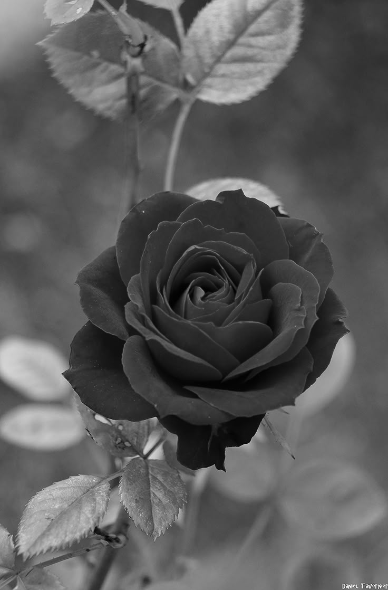

# Pengolahan Citra Digital: Konversi RGB ke Grayscale

Proyek praktikum mata kuliah Pengolahan Citra Digital (Teknik Informatika) yang mengubah citra berwarna (RGB) menjadi citra grayscale menggunakan **Python** dan **OpenCV**. Proyek ini mencakup pembacaan citra, konversi ruang warna, visualisasi perbandingan, penyimpanan hasil, dan verifikasi berkas keluaran.


---

## Deskripsi

Konversi citra berwarna ke grayscale adalah tahap prapemrosesan (*preprocessing*) yang mendasar dalam pengolahan citra digital. Citra berwarna menyimpan tiga kanal per piksel, sedangkan citra grayscale hanya satu kanal intensitas. Dengan konversi ini, volume data dan beban komputasi berkurang, sementara informasi struktural seperti bentuk, tekstur, dan kontras tetap terjaga.

Proyek ini menggunakan citra **bunga mawar merah** sebagai objek uji.

## Fitur

- Membaca citra dengan validasi kesalahan (berkas tidak ditemukan atau rusak)
- Konversi urutan kanal BGR ke RGB agar warna tampil benar di Matplotlib
- Konversi citra berwarna ke grayscale dengan `cv2.cvtColor`
- Visualisasi perbandingan citra asli dan hasil secara berdampingan
- Penyimpanan hasil ke format PNG (lossless)
- Verifikasi hasil dengan membaca ulang berkas keluaran

## Struktur Proyek

```
pengolahan_citra_digital/
├── main.ipynb                  # Notebook utama berisi seluruh proses
├── red flower.jpg              # Citra masukan (berwarna)
├── hasil_grayscale_mawar.png   # Citra keluaran (grayscale)
└── README.md                   # Dokumentasi proyek
```

## Prasyarat

- Python 3.8 atau lebih baru
- Jupyter Notebook atau JupyterLab (atau VS Code dengan ekstensi Jupyter)
- Pustaka Python berikut:

| Pustaka | Fungsi |
|---|---|
| `opencv-python` | Membaca, mengonversi, dan menyimpan citra |
| `numpy` | Operasi array dan matriks |
| `matplotlib` | Visualisasi citra |

## Cara Menjalankan

1. **Clone atau unduh** repositori ini, lalu masuk ke direktorinya.

   ```bash
   cd pengolahan_citra_digital
   ```

2. **(Opsional) Buat virtual environment.**

   ```bash
   python -m venv venv
   source venv/bin/activate      # Windows: venv\Scripts\activate
   ```

3. **Instal dependensi.**

   ```bash
   pip install opencv-python numpy matplotlib notebook
   ```

4. **Jalankan Jupyter Notebook.**

   ```bash
   jupyter notebook main.ipynb
   ```

5. Jalankan seluruh sel secara berurutan (**Run All**). Pastikan `red flower.jpg` berada di folder yang sama dengan notebook.

## Alur Pemrosesan

| Tahap | Proses | Fungsi Utama |
|:---:|---|---|
| 1 | Impor pustaka | `cv2`, `numpy`, `matplotlib`, `os` |
| 2 | Membaca citra dan validasi | `cv2.imread()` |
| 3 | Konversi BGR ke RGB untuk tampilan | `cv2.cvtColor(..., COLOR_BGR2RGB)` |
| 4 | Konversi ke grayscale | `cv2.cvtColor(..., COLOR_BGR2GRAY)` |
| 5 | Visualisasi perbandingan | `plt.subplot()`, `plt.imshow()` |
| 6 | Penyimpanan dan verifikasi | `cv2.imwrite()`, `cv2.imread(..., IMREAD_GRAYSCALE)` |

Potongan inti kodenya:

```python
import cv2

gambar = cv2.imread("red flower.jpg")
if gambar is None:
    raise ValueError("Gambar gagal dibaca!")

gambar_gray = cv2.cvtColor(gambar, cv2.COLOR_BGR2GRAY)
cv2.imwrite("hasil_grayscale_mawar.png", gambar_gray)
```

## Hasil

| Citra Asli | Citra Grayscale |
|:---:|:---:|
|  |  |

Ringkasan properti citra:

| Properti | Citra Asli | Citra Grayscale |
|---|---|---|
| Dimensi (tinggi × lebar) | 1118 × 736 piksel | 1118 × 736 piksel |
| Jumlah kanal | 3 (BGR) | 1 |
| Tipe data | `uint8` | `uint8` |
| Format berkas | JPEG | PNG |
| Rata-rata intensitas | R 104,85 / G 86,30 / B 70,86 | 90,09 |

Berkas hasil yang disimpan identik piksel demi piksel dengan hasil konversi di memori (diverifikasi dengan `numpy.array_equal`).

## Konsep Teknis

**Urutan kanal BGR.** OpenCV membaca citra dengan urutan Blue-Green-Red, sedangkan Matplotlib menggunakan Red-Green-Blue. Tanpa konversi, warna merah pada mawar akan tampil sebagai biru.

**Rumus grayscale.** Konversi memakai rata-rata berbobot sesuai sensitivitas penglihatan manusia (standar ITU-R BT.601):

```
Gray = 0.299 × R + 0.587 × G + 0.114 × B
```

**Parameter `vmin=0, vmax=255`.** Dipakai pada `plt.imshow` agar skala keabuan ditampilkan penuh dan konsisten, tanpa normalisasi otomatis oleh Matplotlib.

**Format PNG.** Dipilih karena bersifat lossless sehingga data hasil tidak berubah saat disimpan.

## Pengembangan Lanjutan

- Peningkatan kontras dengan histogram equalization atau CLAHE
- Thresholding dan segmentasi untuk memisahkan objek dari latar belakang
- Deteksi tepi (Sobel, Canny)
- Perbandingan metode grayscale lain (rata-rata sederhana, desaturasi)
- Pemrosesan batch untuk banyak citra sekaligus

## Penulis

| | |
|---|---|
| **Nama** | Novianti Ramadhnai |
| **NIM** | 24260011 |
| **Program Studi** | Teknik Informatika |
| **Mata Kuliah** | Pengolahan Citra Digital |

## Lisensi

Proyek ini dibuat untuk keperluan pembelajaran. Tambahkan lisensi sesuai kebutuhan (misalnya MIT) sebelum dipublikasikan.
